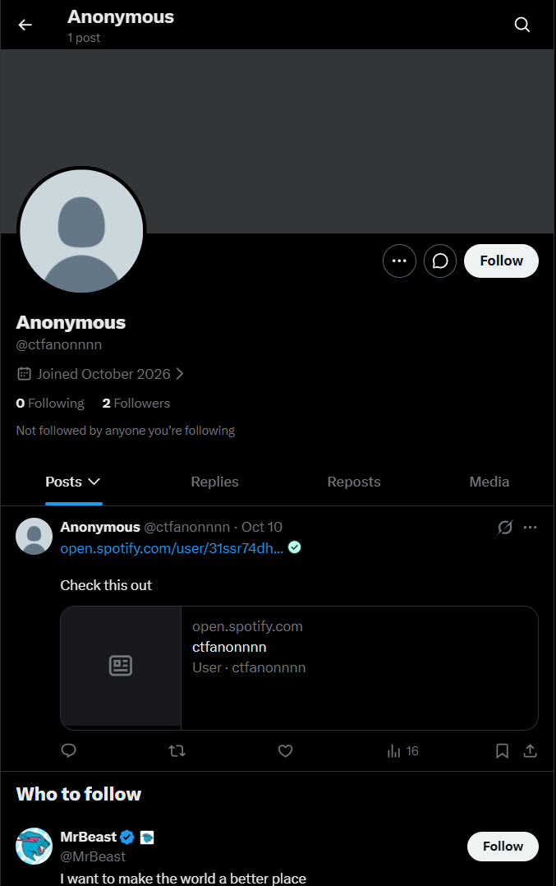
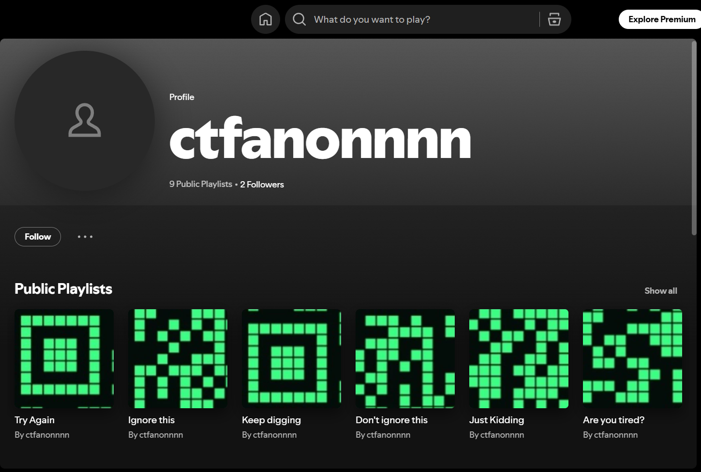

# 🕵️ The Anonymous Playlist — OSINT Challenge


> A multi-stage OSINT investigation involving cross-platform identity discovery, shortened URL analysis, public asset extraction, image reconstruction, and QR code decoding.

---

## 📌 Table of Contents

- [Executive Summary](#-executive-summary)
- [Vulnerability Details](#-vulnerability-details)
- [QR Code Fragmentation](#-qr-code-fragmentation)
- [Exploitation Walkthrough](#-exploitation-walkthrough)
- [Impact](#-impact)
- [Root Cause](#-root-cause)
- [Remediation](#-remediation-and-defensive-guidelines)
- [Conclusion](#-conclusion)

---

## 🎯 Executive Summary

This investigation focused on cross-platform digital footprinting, HTTP redirect analysis, public asset extraction, and image reconstruction.

The investigation began with the handle `@ctfanonnnn`, which led to a public X profile containing a shortened URL. Following the redirect revealed an anonymous Spotify user profile containing nine public playlists. Although the playlists had no audio tracks, each contained a unique cover image.

The nine images were fragments of a larger QR code. By analyzing pixel continuity along their boundaries, the correct column-major arrangement was identified. The images were then assembled into a 3 × 3 matrix, producing a QR code that could be decoded to retrieve the challenge flag.

### 🏁 Challenge Flag

`V3ct0r{h1d3_n_l3375}`

The challenge demonstrated how publicly accessible information distributed across multiple platforms can be correlated and reconstructed to reveal concealed data.

---

## 🔍 Vulnerability Details

### Classification

| Classification | Description |
|---|---|
| **CWE-200** | Exposure of Sensitive Information to an Unauthorized Actor |
| **CWE-538** | Insertion of Sensitive Information into Externally-Accessible File or Directory |

These classifications describe the information-exposure theme of the challenge. The demonstrated result was the recovery of concealed challenge data from public assets; the evidence provided does not independently establish a vulnerability in the X or Spotify platforms themselves.

### Root Cause

The challenge relied on the discoverability and correlation of information distributed across public profiles and media assets.

Several individually accessible resources contributed to the final result:

- A public social media profile containing a shortened URL.
- A redirect leading to another public platform.
- A Spotify profile containing nine playlists.
- Nine cover images containing fragments of a larger visual payload.

The concealed information could be recovered because the image fragments retained enough visual information to be arranged into a valid QR code.

---

## 🧩 QR Code Fragmentation

Each playlist cover image measured **300 × 300 pixels**. The nine images were intended to be assembled into a 3 × 3 matrix.

The correct arrangement was **column-major**, rather than the conventional row-major ordering.

```text
┌────────┬────────┬────────┐
│   t1   │   t4   │   t7   │
├────────┼────────┼────────┤
│   t2   │   t5   │   t8   │
├────────┼────────┼────────┤
│   t3   │   t6   │   t9   │
└────────┴────────┴────────┘
```

Boundary pixel-density analysis helped identify the relationship between adjacent tiles. The reconstructed image formed a **Version 2 QR code with a 25 × 25 module grid**.

The three QR finder patterns provided additional structural evidence for checking the proposed arrangement.

---

## 🛠️ Exploitation Walkthrough

### Step 1 — Cross-Platform Reconnaissance

The investigation began by searching for the target handle across public social media platforms using Sherlock.

```bash
sherlock ctfanonnnn --timeout 10
```

The investigation notes report potential profiles on X, Instagram, Threads, and Spotify.

The X profile contained a post linking to a shortened URL:

```text
Anonymous (@ctfanonnnn)
Check this out: https://t.co/d40vjx8ysL
```

**X profile evidence**



This link provided the next lead in the investigation.

### Step 2 — Redirect Analysis

The shortened URL redirected to:

```text
https://open.spotify.com/user/31ssr74dhhufdkik2dniidoeqwrq
```

Following the redirect led to the target's Spotify profile, where the next set of publicly accessible assets could be investigated.

### Step 3 — Spotify Profile and Asset Extraction

The Spotify profile contained nine public playlists. All nine had zero audio tracks, but each displayed a unique cover image.

**Spotify playlist evidence**



The playlist names and IDs were recorded as follows:

| Playlist | Playlist ID |
|---|---|
| Try Again | `29OwF03v3LglkKID51mqAu` |
| Ignore this | `4sJzovwomZYWrB0JLjKgI4` |
| Keep digging | `6yqXE0wSmGnp3lqT98Zh06` |
| Don't ignore this | `0SIBH8cfxh6hQYOhlMCTow` |
| Just Kidding | `20efh64cs6QRzzWAlVKkHE` |
| Are you tired? | `5Kemo2Bqd552MzzJDeCn8T` |
| More way to go | `41IOdO6Vwsv4xlKR62mWtw` |
| Something's missing | `0oFGmwodtqdRCUvBH3xLcf` |
| Put Me Together | `7tBRL4XEwWG0kynpsCXuUN` |

Each cover image measured 300 × 300 pixels.

The combination of empty playlists and nine distinct images suggested that the artwork, rather than the audio content, was the relevant part of the challenge.

### Step 4 — Boundary Pixel-Density Analysis

To determine how the tiles fitted together, the supplied analysis examined pixel-density values along the top, bottom, left, and right edges of each image.

```text
1_Try_Again:          Top:   0, Left:   0, Bottom: 152, Right:  94
2_Ignore_this:        Top: 155, Left:   0, Bottom: 125, Right:  95
3_Keep_digging:       Top: 125, Left:   0, Bottom:   0, Right: 156
4_Dont_ignore_this:   Top:   0, Left:  95, Bottom: 212, Right: 127
5_Just_Kidding:       Top: 217, Left:  96, Bottom: 123, Right: 212
6_Are_you_tired:      Top: 123, Left: 158, Bottom:   0, Right: 225
7_More_way_to_go:     Top:   0, Left: 121, Bottom:  63, Right:   0
8_Somethings_missing: Top:  65, Left: 200, Bottom: 223, Right:   0
9_Put_Me_Together:    Top: 223, Left: 213, Bottom:   0, Right:   0
```

The measurements supported several observations:

1. **Vertical continuity:** The bottom-edge patterns of tiles `t1` and `t2`, and of `t2` and `t3`, were consistent with vertical adjacency.
2. **Horizontal continuity:** The right-edge patterns of `t1` and `t4`, and of `t4` and `t7`, were consistent with horizontal adjacency.
3. **Corner patterns:** Several tiles had low-density outer boundaries consistent with the quiet zones surrounding a QR code.

Together, these observations supported the following arrangement:

```text
┌────┬────┬────┐
│ t1 │ t4 │ t7 │
├────┼────┼────┤
│ t2 │ t5 │ t8 │
├────┼────┼────┤
│ t3 │ t6 │ t9 │
└────┴────┴────┘
```

The assembled image displayed the expected QR code structure, including its three finder patterns.

### Step 5 — Automated QR Reconstruction

The reconstruction script used Python, Pillow, and `pyzbar` to load the nine tiles, place them in the identified arrangement, save the composite image, and attempt to decode the QR code.

```python
from PIL import Image
from pyzbar.pyzbar import decode

tiles = [
    Image.open(f"../assets/{name}.jpg")
    for name in [
        "1_Try_Again",
        "2_Ignore_this",
        "3_Keep_digging",
        "4_Dont_ignore_this",
        "5_Just_Kidding",
        "6_Are_you_tired",
        "7_More_way_to_go",
        "8_Somethings_missing",
        "9_Put_Me_Together",
    ]
]

width, height = tiles[0].size
canvas = Image.new("RGB", (width * 3, height * 3))

grid = [
    [tiles[0], tiles[3], tiles[6]],
    [tiles[1], tiles[4], tiles[7]],
    [tiles[2], tiles[5], tiles[8]],
]

for row in range(3):
    for col in range(3):
        canvas.paste(
            grid[row][col],
            (col * width, row * height)
        )

canvas.save("../assets/qr_reconstructed.png")

for result in decode(canvas):
    print(f"[+] Flag found: {result.data.decode('utf-8')}")
```

The script implements the column-major placement identified during the boundary analysis. It then saves the reconstructed image and passes it to the QR decoder.

The script assumes that the nine image files exist at the specified relative paths and that the required Python dependencies are installed.

### Step 6 — Flag Retrieval

Decoding the reconstructed QR code yielded the challenge flag:

```text
V3ct0r{h1d3_n_l3375}
```

This completed the investigation, connecting the original social media profile to the shortened URL, the Spotify playlist artwork, and the final decoded value.

---

## 💥 Impact

The demonstrated results within the CTF environment included:

- Correlating public profiles associated with the target handle.
- Discovering a destination through shortened-link analysis.
- Identifying the significance of otherwise unusual playlist artwork.
- Reconstructing a concealed visual payload from nine image fragments.
- Recovering the challenge flag without relying on a dedicated flag-retrieval endpoint.

In a real-world scenario, similar techniques could expose information that an individual or organization intended to keep obscure. The actual impact would depend on the sensitivity of the exposed content and the surrounding access controls.

The exercise demonstrates that information exposure should be evaluated across related assets and platforms, rather than only one resource at a time.

---

## 🧠 Root Cause

The challenge's central weakness was the ability to recover concealed information by correlating publicly accessible resources.

The investigation established the following chain:

1. A public handle led to a social media profile.
2. A shortened URL revealed a link to another platform.
3. The linked profile exposed nine image assets.
4. The image fragments retained enough visual structure to determine their relative positions.
5. The reconstructed matrix could be decoded as a QR code.

The concealment depended on discovering the relationship between the assets and determining their arrangement. It did not provide a meaningful confidentiality boundary against someone who could access and reconstruct all the fragments.

---

## 🛡️ Remediation and Defensive Guidelines

### 1. Minimize Unintended Public Exposure

Review public profiles, posts, media assets, and linked resources before publication. Avoid placing sensitive information in publicly accessible content when confidentiality is required.

### 2. Review Cross-Platform Identity Exposure

Assess whether usernames, profile descriptions, and linked accounts reveal connections that were not intended to be public. Use separate identities where appropriate for privacy, and avoid assuming that different platforms provide independent anonymity.

### 3. Audit Shortened URLs

Verify the destination and intended visibility of shortened links before publishing them. A shortened URL obscures the destination in its displayed form but should not be treated as an access-control mechanism.

### 4. Protect Sensitive Assets With Access Controls

Do not rely on obscurity, image fragmentation, or unusual asset placement to protect confidential data. Apply appropriate access controls to the underlying resource.

### 5. Inspect Media Metadata

Remove unnecessary EXIF, IPTC, and other metadata from public media where appropriate. However, metadata sanitization alone will not prevent reconstruction if sensitive information remains visible in the image content.

### 6. Conduct Digital-Footprint Reviews

Periodically assess publicly discoverable profiles, links, and media assets to determine whether their combination reveals information beyond what each resource appears to disclose individually.

---

## 🏁 Conclusion

The Anonymous Playlist challenge demonstrated a multi-stage OSINT investigation involving username enumeration, HTTP redirect analysis, public asset extraction, image-boundary analysis, and QR code reconstruction.

The key discovery was that the nine empty Spotify playlists contained cover images that were fragments of a larger QR code. By determining the column-major arrangement and reconstructing the composite image, the concealed flag was recovered.

The main lesson is that **seemingly harmless public assets can reveal additional information when their relationships are identified and analyzed together**.

### 🏆 Final Flag

`V3ct0r{h1d3_n_l3375}`

---

*Disclaimer: This write-up documents a controlled CTF challenge. The findings demonstrate OSINT and reconstruction techniques and do not, by themselves, establish a security vulnerability in X or Spotify.*
