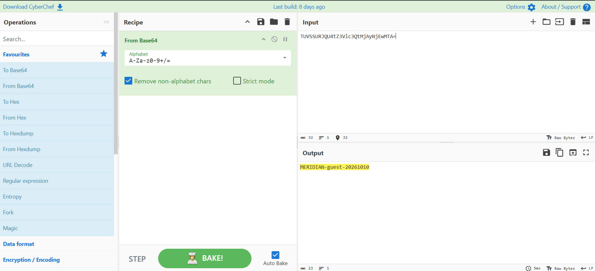
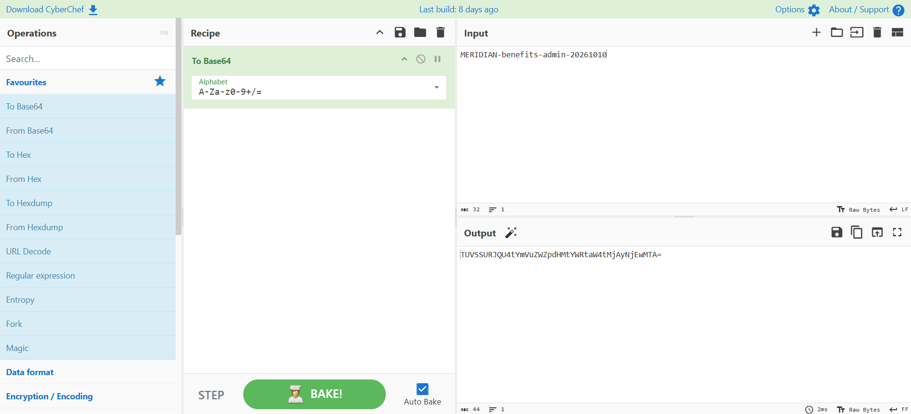
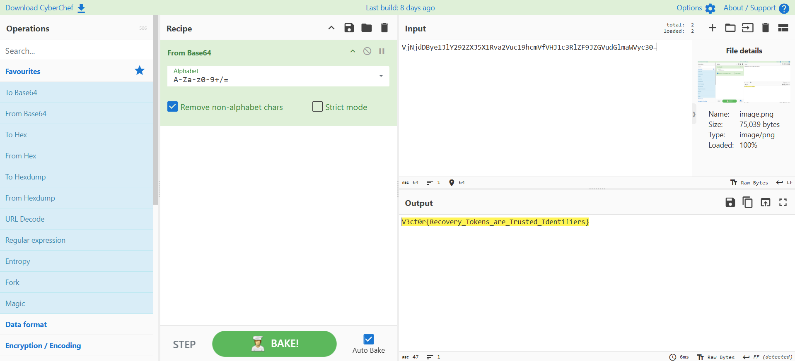

# 🔐 Meridian Technologies — Password Reset Vulnerability

<p align="center">
  
  
  
</p>

---

## 🎯 Assessment Overview

| **Field** | **Details** |
|:---|:---|
| **Target** | [Meridian Technologies](https://web2.cybernexus.live) |
| **Category** | Web Application Security |
| **Primary Vulnerability** | Predictable Password Reset Tokens |
| **Related Vulnerability** | Account Enumeration |
| **CWE** | CWE-640, CWE-204 |
| **Flag** | `V3ct0r{Recovery_Tokens_are_Trusted_Identifiers}` |

---

## 📑 Table of Contents

- [1. Executive Summary](#1-executive-summary)
- [2. Vulnerability Details](#2-vulnerability-details)
  - [2.1 Predictable Password Recovery Token](#21-predictable-password-recovery-token)
  - [2.2 Account Enumeration](#22-account-enumeration)
- [3. Exploitation Walkthrough](#3-exploitation-walkthrough)
  - [Step 1: Initial Access and Reconnaissance](#step-1-initial-access-and-reconnaissance)
  - [Step 2: Analyze the Recovery Token](#step-2-analyze-the-recovery-token)
  - [Step 3: Construct the Administrative Token](#step-3-construct-the-administrative-token)
  - [Step 4: Access the Administrative Workspace](#step-4-access-the-administrative-workspace)
  - [Step 5: Retrieve the Flag](#step-5-retrieve-the-flag)
- [4. Impact](#4-impact)
- [5. Root Cause](#5-root-cause)
- [6. Remediation](#6-remediation)
- [7. Conclusion](#7-conclusion)

---

## 1. Executive Summary

The Meridian Technologies workforce portal contained a password recovery vulnerability that allowed administrative account takeover through predictable reset tokens.

Analysis of the recovery workflow revealed that tokens followed the format `MERIDIAN-<username>-<YYYYMMDD>` and were encoded using standard Base64. Since Base64 is reversible encoding rather than encryption, the token structure could be identified from a recovery token generated for the low-privilege `guest` account.

The `/forgot-password` endpoint also returned different messages for registered and unregistered usernames, allowing account enumeration.

By combining these weaknesses, a recovery token was constructed for the `benefits-admin` account. The application accepted the token, allowed the password to be reset, and provided access to the administrative workspace. The challenge flag was subsequently recovered from an internal verification note.

---

## 2. Vulnerability Details

### 2.1 Predictable Password Recovery Token

**CWE-640 — Weak Password Recovery Mechanism**

**Related weakness:** CWE-330 — Use of Insufficiently Random Values

The password recovery mechanism used a predictable token structure:

```text
MERIDIAN-<username>-<YYYYMMDD>
```

The resulting string was encoded using Base64 without evidence of a cryptographically secure, unpredictable token-generation mechanism.

**Guest recovery token:**

```text
TUVSSURJQU4tZ3Vlc3QtMjAyNjEwMTA=
```

**Decoded value:**

```text
MERIDIAN-guest-20261010
```

This revealed the static prefix, username, and date components.

Base64 does not provide cryptographic protection. Because the underlying token was predictable, a corresponding value could be constructed for another account.

### 2.2 Account Enumeration

**CWE-204 — Observable Response Discrepancy**

The `/forgot-password` endpoint returned different responses depending on whether the submitted username existed.

**Registered account:**

```text
A recovery message has been generated for your account.
```

**Unregistered account:**

```text
If the account exists, a recovery message has been generated.
```

These different messages exposed account existence to unauthenticated users.

During initial reconnaissance, the internal mailbox at `/mail/2/` contained an operational note identifying the administrative queue owner:

```text
Queue owner: benefits-admin
```

Submitting this username to the recovery endpoint returned the registered-account response, confirming that the account existed.

---

## 3. Exploitation Walkthrough

### Step 1: Initial Access and Reconnaissance

The challenge-provided low-privilege account was used to access the workforce portal.

The internal mailbox was inspected for operational information. A message identified the administrative queue owner as `benefits-admin`, providing a target for further testing.

### Step 2: Analyze the Recovery Token

A password recovery request was made for the `guest` account. The generated recovery link contained the following token:

```text
TUVSSURJQU4tZ3Vlc3QtMjAyNjEwMTA=
```

It was a Base64 string. Decoding it revealed what it contained:



**Output:**

```text
MERIDIAN-guest-20261010
```

The decoded result exposed the token-generation pattern.

### Step 3: Construct the Administrative Token

Using the observed structure, the candidate payload for `benefits-admin` was:

```text
MERIDIAN-benefits-admin-20261010
```

Encoding it using Base64:



**Result:**

```text
TUVSSURJQU4tYmVuZWZpdHMtYWRtaW4tMjAyNjEwMTA=
```

The constructed token was submitted to the challenge's password-reset functionality.

**Server response:**

```text
Password Updated — Password has been updated successfully.
```

This confirmed that the application accepted the constructed token and allowed the administrative account's password to be changed.

### Step 4: Access the Administrative Workspace

After the password reset, the application was accessed using the administrative account.

The following routes were visited:

```text
/benefits-admin
/benefits-admin/notes
```

The internal notes section contained a verification note with a Base64-encoded value.

### Step 5: Retrieve the Flag

The encoded verification value was:

```text
VjNjdDBye1JlY292ZXJ5X1Rva2Vuc19hcmVfVHJ1c3RlZF9JZGVudGlmaWVyc30=
```

Decoding the value revealed the challenge flag:



```text
V3ct0r{Recovery_Tokens_are_Trusted_Identifiers}
```

This completed the demonstrated exploitation chain, from identifying the recovery weakness to obtaining administrative access and retrieving the flag.

---

## 4. Impact

The demonstrated impact in the CTF environment included:

- Account enumeration through inconsistent recovery responses.
- Forging a password recovery token for a privileged account.
- Unauthorized password reset of the administrative account.
- Access to the administrative workspace.
- Retrieval of the internal challenge flag.

In a real application, a similar weakness could expose sensitive information or allow administrative account takeover, depending on the privileges and resources available to the compromised account.

---

## 5. Root Cause

The primary root cause was the use of predictable information to construct a password-reset token.

The token depended on a static prefix, an account identifier, and a date. Base64 encoding did not make the token unpredictable or prevent forgery.

The account-enumeration issue further assisted the attack by allowing the existence of the target administrative account to be confirmed.

Together, these weaknesses undermined the security of the account recovery process.

---

## 6. Remediation

### 🔑 Use Cryptographically Secure Tokens

Generate reset tokens using a cryptographically secure random number generator. Do not derive them solely from usernames, dates, or other predictable values.

### 🛡️ Validate Tokens Securely

Bind each token to the intended account and recovery operation, and validate it on the server side.

### ⏱️ Enforce Expiration and Single Use

Reset tokens should expire after a limited period and become invalid after successful use.

### 🔒 Prevent Account Enumeration

Return consistent responses for registered and unregistered usernames, avoiding observable differences that disclose account existence.

### 📊 Apply Rate Limiting and Monitoring

Restrict excessive recovery requests and monitor suspicious activity targeting multiple accounts or privileged users.

### 🔔 Protect Compromised Accounts

Invalidate relevant sessions after password resets, notify account owners, and maintain security logs for investigation.

---

## 7. Conclusion

This CTF challenge demonstrated how predictable password recovery tokens can undermine authentication security.

By analyzing the recovery workflow, identifying a response discrepancy, decoding the generated token, and testing the observed construction, it was possible to demonstrate administrative account takeover in the challenge environment.

The key lesson is that password recovery must rely on unpredictable credentials and strict server-side validation. Encoding a predictable identifier with Base64 is not a substitute for a secure token-generation mechanism.

---

<p align="center">
  <strong>🏁 V3ct0r{Recovery_Tokens_are_Trusted_Identifiers}</strong>
  <br>
  <sub>V3CT0R CTF 2026 · Authorized challenge environment</sub>
</p>
